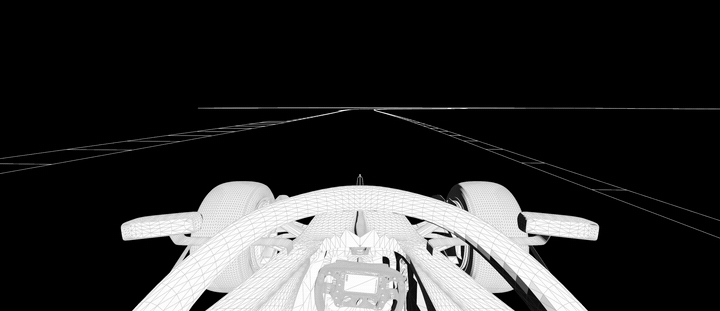
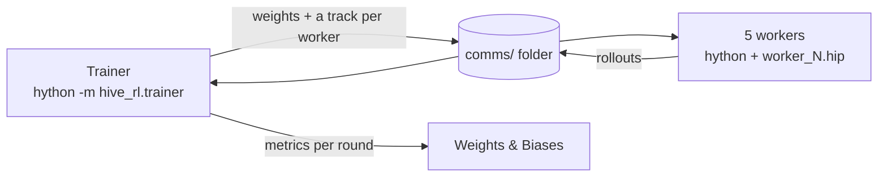

<p align="center">
  
</p>

<h1 align="center">Houdini Reinforcement Learning Race Car</h1>

<p align="center">A self-driving race car trained with PPO inside SideFX Houdini.</p>

<p align="center">
  <a href="https://github.com/yutohw/hive-rl/actions/workflows/ci.yml"></a>
</p>

<p align="center">
  ▶ <a href="https://www.youtube.com/watch?v=A0ulPi4lGK8"><b>Watch the talk: Reinforcement Learning Within Houdini</b></a> · Yuto · SideFX HIVE alt London
</p>

---

## What it is

A PPO agent learns to drive a race car around five circuits (Monza, Spa, Barcelona, Interlagos and Silverstone) in an environment built entirely from Houdini SOPs. This repo is the self-driving-car half of the HIVE alt London talk: the training code, with the Houdini scenes as release assets.

- **Environment:** a SOP network steps the car each frame. The agent sees an 18-value, lidar-style state. The reward, written in VEX, pays for progress and speed, penalises drifting from the centreline and crawling, and takes 1 away on a collision.
- **Agent:** an actor-critic network in PyTorch. A tanh-squashed Gaussian outputs steer (−1 to 1), throttle and brake (0 to 1). It's trained with clipped PPO and GAE, a cosine learning-rate schedule and decaying entropy.
- **Training:** headless. One trainer and five `hython` workers swap weights and rollouts through files. A curriculum starts on Monza and adds a circuit every 8% of training until all five are in play at 32%. Every round is logged to Weights & Biases.
- **Inference:** inside the Houdini GUI from a Python Script node, recorded to `.bgeo.sc` caches.



---

## Results

The released policy, run once per circuit in the Houdini GUI and recorded to `inference.cache.zip`:

| Track | Steps driven | Collisions | Episode return | Mean speed | Slowest after launch |
|---|---:|---:|---:|---:|---:|
| Monza | 1,440 | 0 | 1,130.1 | 124.9 | 82.3 |
| Spa | 1,440 | 0 | 1,123.9 | 124.3 | 78.9 |
| Barcelona | 1,440 | 0 | 1,114.7 | 123.6 | 75.1 |
| Interlagos | 1,440 | 0 | 1,118.0 | 123.9 | 71.9 |
| Silverstone | 2,048 | 0 | 2,004.4 | 120.8 | 55.4 |

- **Steps driven** are recorded frames: 1,440 is 60 seconds at 24 fps. Silverstone was recorded for 2,048 steps, so its return isn't comparable with the others.
- **Collisions** count frames with the collision flag set, over every frame.
- **Speeds** are in the simulation's own units; top speed is about 126.5. **Slowest after launch** is the lowest speed once the car first reaches 95% of its top speed: the tightest corner, not the standing start.

Rebuild the table from the caches with `hython -m hive_rl.results "<inference cache folder>"` (step 5 below).

Training curves from a short demo run: [W&B project](https://forge.coreweave.com/wandb/yuto-yutohw/hive-rl).

---

## Reproduce

### Requirements

- **Houdini 20.0.724**, the version the project was built and tested in
- **Windows**: the scripts use Windows paths and `os.replace()` for atomic writes
- **PyTorch**, and **Weights & Biases** for training logs (step 2)

Houdini 20.0 ships **Python 3.10**, so the virtual environment must be built from Houdini's own interpreter. The networks are small and run on CPU, so CUDA is not required.

**Keep the versions aligned.** The Houdini build, the Python version and the PyTorch wheel all have to match: build the venv from the `python3XX` interpreter inside your own Houdini install, and install a PyTorch wheel for that Python version. A venv built from the wrong Python imports fine in a terminal but fails inside Houdini.

### 1. Get the files

Download the three assets from the [latest release](https://github.com/yutohw/hive-rl/releases/latest). The repository itself carries only source.

| Asset | Contents |
|---|---|
| `houdini.files.zip` | `inference.hip` and `worker_1.hip` |
| `inference.cache.zip` | The five recorded runs in the results table |
| `Self_Driving_Agent_Example_01.pth` | The trained policy |

### 2. Set up Houdini's Python

Create a virtual environment from Houdini's Python:

```bat
"C:\Program Files\Side Effects Software\Houdini 20.0.724\python310\python.exe" -m venv houdini_pytorch_env
houdini_pytorch_env\Scripts\activate
python --version
```

It should report `Python 3.10.x`. If `venv` fails with an `ensurepip` error, create it with `--without-pip` and then run `houdini_pytorch_env\Scripts\python.exe -m ensurepip --upgrade`.

Install PyTorch (CPU build) and W&B:

```bat
pip install torch --index-url https://download.pytorch.org/whl/cpu
pip install "wandb>=0.31"
wandb login
```

Install `torch` only: `torchvision` and `torchaudio` pull in NumPy 2.x, which conflicts with the NumPy Houdini bundles. If you need NumPy in the venv, pin it with `pip install "numpy<2"`. `wandb login` asks for the key from [wandb.ai/authorize](https://wandb.ai/authorize) and stores it in your user folder. Training works without W&B too: see step 3.

Point Houdini at the venv and at this repo. Open (or create) `C:\Users\<YourUsername>\Documents\houdini20.0\houdini.env` and add:

```
PYTHONPATH = C:/Users/<YourUsername>/dev/hive-rl/src;C:/Users/<YourUsername>/houdini_pytorch_env/Lib/site-packages;$PYTHONPATH
PATH = C:/Users/<YourUsername>/houdini_pytorch_env/Scripts;$PATH
```

The first entry is the `src` folder of your clone, so `hython` can import `hive_rl`. Use forward slashes and `;` separators. Houdini only reads this file at launch, so restart it afterwards. Then check the headless interpreter, which training depends on:

```bat
"C:\Program Files\Side Effects Software\Houdini 20.0.724\bin\hython.exe" -c "import torch, wandb, hive_rl; print(torch.__version__, wandb.__version__, hive_rl.__file__)"
```

It should print both versions and a path inside your clone's `src\hive_rl`. If the GUI works but `hython` doesn't, `houdini.env` wasn't picked up.

### 3. Train

**Set the paths** in `src/hive_rl/config.py`:

```python
base_dir = r"D:\your\project\folder"  # working directory
num_workers = 5  # must match the number of workers you start
use_wandb = True  # False turns W&B logging off
```

`comms/`, `model/` and W&B's local `wandb/` folder are created under `base_dir`. `comms/` holds assignments, rollouts, per-round weights and done flags; old rounds are cleaned up automatically.

**Create the worker scene files.** Only `worker_1.hip` ships in the release, and each worker needs its own copy so instances don't contend over one file. Copy it in `base_dir` as `worker_1.hip` to `worker_5.hip`. The count must match `num_workers`: if a scene is missing, or fewer workers run than `num_workers`, the trainer waits forever.

**Start the workers.** The venv doesn't need activating: `hython` finds everything through `houdini.env`. Save this as `start_workers.bat` and run it:

```bat
@echo off
set HYTHON="C:\Program Files\Side Effects Software\Houdini 20.0.724\bin\hython.exe"
for /L %%i in (1,1,5) do start "Worker %%i" %HYTHON% -m hive_rl.worker %%i
```

Each worker prints `=== Worker N started, waiting for assignments ===`. Each is a full Houdini session, so check you have the licences and the RAM for five.

**Start the trainer** in one more terminal:

```bat
"C:\Program Files\Side Effects Software\Houdini 20.0.724\bin\hython.exe" -m hive_rl.trainer
```

Each round it writes the weights, assigns a track per worker, waits for all rollouts, runs the PPO update, prints a summary line and logs the round to W&B:

```
Round  120 | Episodes  600 | T0:287 | T2:412 | ... | Avg100  1843.21 | LR 4.98e-04 | Ent 0.0495 | LogStd -0.912
```

`T<track>:<steps>` is the track and last step index per worker. Watch `Avg100` for progress and `LogStd` for entropy pressure: climbing towards positive values means the entropy coefficient is too strong.

**What W&B shows**, with episodes on the x-axis:

| Metric | Meaning |
|---|---|
| `return/avg100`, `return/mean` | Mean episode return over the last 100 episodes, and over this round |
| `return/monza` … `return/silverstone` | Return per circuit, as each joins the curriculum |
| `steps/completion` | Steps driven ÷ `max_steps`: how far the car gets before crashing |
| `loss/policy`, `loss/value`, `loss/entropy` | PPO losses, averaged over the epochs of each update |
| `loss/approx_kl`, `loss/clip_fraction` | How far each update moves the policy, and how often PPO's clip applies |
| `schedule/lr`, `schedule/entropy_coef`, `policy/log_std` | The schedules, and the policy's exploration noise |

Runs record hyperparameters and metrics only: the PC name, user folders, command line, git details and source code are switched off in `src/hive_rl/tracking.py`. Set `WANDB_MODE=offline` to log without a network and upload later with `wandb sync`, or `WANDB_MODE=disabled` to turn W&B off.

**Output.** Checkpoints go to `model/checkpoint_<episodes>.pth` every 100 rounds. When `num_episodes` is reached, the best model from the final 10% of training is saved to `model/Self_Driving_Agent_Example_01.pth`, so use the checkpoints if you stop early.

### 4. Run inference

Inference runs in the **Houdini GUI**; nothing is launched from a terminal.

1. Extract `houdini.files.zip` and open `inference.hip`. Extract `inference.cache.zip` and put the five track folders inside a `Recording` folder next to `inference.hip`.
2. Rename `260903_Inference_Spa_01` to `260906_Inference_Spa_01`: the Spa node expects that name.
3. Open the Python Script node `/obj/Inference_Script` and edit its config block. `model_path` is the only value that must change:

    ```python
    model_path = r"C:\path\to\Self_Driving_Agent_Example_01.pth"  # or any checkpoint
    track = 3  # 0 Monza, 1 Spa, 2 Barcelona, 3 Interlagos, 4 Silverstone
    max_steps = 1440
    ```

    The node keeps its own copy of the network, so it doesn't import `hive_rl`. If you change `ActorCritic` in `src/hive_rl/model.py`, change it there too.
4. Inside `/obj/Inference_Environment`, point `Result_Recorder_01` at a new folder, for example `$HIP/Recording/My_Inference_Run_01`, so you don't overwrite a cache.
5. Execute `Inference_Script`. Progress prints to the Python Shell.

The script runs in two passes. **Rollout:** the policy runs deterministically and stores every action in memory. **Replay:** the environment resets and replays the stored actions, with `Result_Recorder_01` firing each step. Recording inside the step loop would force the upstream solver to re-evaluate and break the simulation's continuity, which is why the passes are split. When it finishes, scrub the timeline to play the run back.

### 5. Rebuild the results table

```bat
"C:\Program Files\Side Effects Software\Houdini 20.0.724\bin\hython.exe" -m hive_rl.results "C:\path\to\inference cache"
```

Point it at the folder holding the track folders. It reads every frame's detail attributes with `hou` and prints the table above as Markdown.

---

## Troubleshooting

**`import torch` works in the GUI but not in `hython`.** Check `houdini.env` uses forward slashes and `;` separators, and lives under `Documents\houdini20.0`.

**`ModuleNotFoundError: No module named 'hive_rl'`.** The `src` path in `houdini.env` is missing or wrong, or Houdini wasn't restarted after editing it.

**Trainer hangs at a round.** Fewer workers are running than `num_workers`, or a worker crashed. Check each worker's terminal.

**Workers run but training doesn't improve.** Check each worker was started with a different ID. The seed comes from it (`base_seed + worker_id * 1000`), and identical IDs produce identical rollouts.

**`PermissionError` on files in `comms/`.** Two processes hit the same file. All writes go through the atomic helpers in `src/hive_rl/comms.py`; check nothing else has the folder open.

**`wandb is not installed: training continues without W&B logging`.** Install it into `houdini_pytorch_env` (step 2), not only into a dev environment.

**The trainer asks for a W&B API key.** Run `wandb login` from `houdini_pytorch_env\Scripts`, or train with `WANDB_MODE=offline`.

**A W&B run shows as crashed after Ctrl+C.** Expected: stopping early never calls `run.finish()`. The logged data is kept.

**The inference cache doesn't load.** Folder names must match the File Cache paths exactly, including the Spa rename in step 4. Frames start at `0002`, so frame 1 is empty.

---

## Development

Linting and tests run in a normal uv environment, separate from Houdini's Python:

```bash
uv sync
uv run ruff check .
uv run ruff format --check .
uv run pytest
```

`hou` and `wandb` are replaced by small fakes in the tests: `tests/test_env_step.py` drives `worker.run_episode` with a fake `hou`, and `tests/test_tracking.py` checks the W&B privacy settings with a fake `wandb`. The per-step reward is VEX inside the scene, so the reward test covers the Python side: turning rewards into returns and advantages.

The same checks run in Docker without installing anything locally:

```bash
docker build -t hive-rl .
docker run --rm hive-rl
```

GitHub Actions runs them on every push (`.github/workflows/ci.yml`).

### Repository layout

| Path | Contents |
|---|---|
| `src/hive_rl/config.py` | Paths, environment constants, PPO hyperparameters, seeding, W&B settings |
| `src/hive_rl/comms.py` | File-based messaging between trainer and workers (paths, atomic writes, cleanup) |
| `src/hive_rl/curriculum.py` | Track selection schedule |
| `src/hive_rl/model.py` | `ActorCritic` network and `TanhNormal` action distribution |
| `src/hive_rl/ppo.py` | LR and entropy schedules, GAE, transition cap, PPO update |
| `src/hive_rl/worker.py` | Rollout collector: one headless Houdini instance per worker |
| `src/hive_rl/trainer.py` | Hands out assignments, gathers rollouts, runs the PPO update, logs to W&B |
| `src/hive_rl/tracking.py` | Weights & Biases run setup and per-round metrics |
| `src/hive_rl/results.py` | Rebuilds the results table from the inference caches |
| `tests/` | Environment step, rewards, policy forward pass, PPO update, W&B logging, results table, checkpoint keys |
| `Dockerfile`, `.github/workflows/ci.yml` | Lint and test in a container, and on every push |
| `docs/media/` | The GIF at the top of this page |

Houdini scenes, inference caches and the trained model are [release assets](https://github.com/yutohw/hive-rl/releases/latest), not tracked in git.

---

## Licence

MIT. See [LICENSE](LICENSE).
